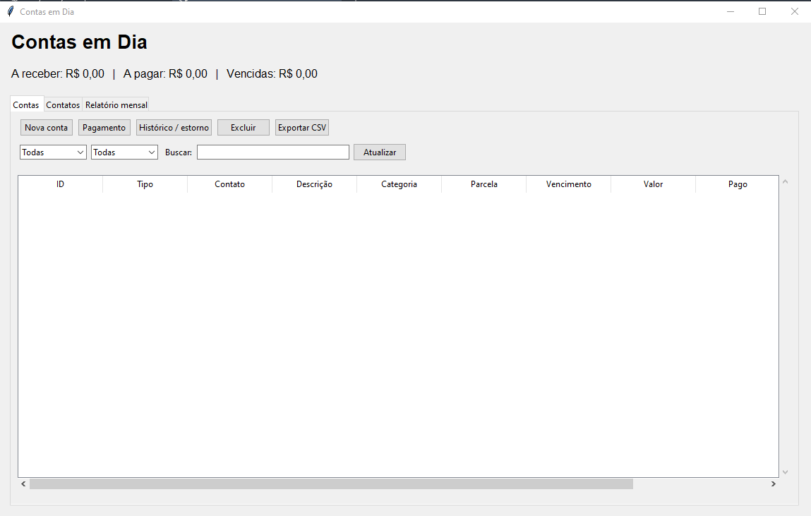

# Contas em Dia

Projeto de estudo em Python para controlar contas a pagar e receber.

## Abrir

Instale Python 3.10 ou superior com Tcl/Tk, extraia o ZIP e abra `iniciar.bat` no Windows. Ou execute na pasta:

```bash
python main.py
```

Não precisa instalar bibliotecas pelo pip. No Linux pode ser necessário instalar `python3-tk`. O programa precisa de uma sessão gráfica e permissão de escrita na pasta.

## Como está organizado

| Arquivo | Papel |
| --- | --- |
| `main.py` | Cria o Model, o Presenter e a View |
| `model.py` | Classe FinanceiroModel: regras de cadastro, banco SQLite e gravações |
| `presenter.py` | Classe FinanceiroPresenter: recebe ações da tela, chama o Model e prepara filtros e relatórios |
| `view.py` | Classe FinanceiroView: formulários, tabelas, mensagens e exportação das linhas exibidas |
| `calculos.py` | Funções de dinheiro, parcelas e datas usadas pelo Model |
| `testes.py` | Testes de cálculos, banco e Presenter sem abrir a interface |

A View acessa o Presenter e não acessa diretamente o Model. O Model não importa a interface. É uma implementação pequena de MVP: não há interfaces abstratas, injeção por framework, ORM ou diversas camadas de repositórios. As mensagens de erro ficam na View e os dados são preparados pelo Presenter. A View também cuida da exportação CSV do conteúdo da tabela.

Para estudar, comece por `calculos.py`, depois `model.py`, `presenter.py`, `main.py` e `view.py`. Procure acompanhar o clique em Nova conta até a gravação no banco.

## Usar

1. Na aba **Contatos**, cadastre um cliente ou fornecedor. Também pode editar os dados.
2. Na aba **Contas**, informe contato, tipo, descrição, categoria, valor TOTAL, primeiro vencimento e parcelas.
3. Selecione uma parcela e clique em **Pagamento**. É possível registrar pagamentos parciais.
4. Consulte o **Histórico / estorno** para corrigir um pagamento errado.
5. Use os filtros por tipo e situação ou busque contato, descrição e categoria.
6. **Exportar CSV** salva as linhas do filtro atual.
7. No **Relatório mensal**, informe `AAAA-MM` e clique em atualizar.

## Regras

Valores positivos, no máximo R$ 999.999.999,00, com até duas casas decimais. Prefira `1250,50` ou `1.250,50`. Sem vírgula, o ponto significa decimal: `25.50` funciona; `1.250` é recusado por ter três casas decimais.

O banco guarda centavos inteiros. R$ 100,00 em três parcelas gera R$ 33,34, R$ 33,33 e R$ 33,33. São permitidas de 1 a 120 parcelas mensais, com pelo menos um centavo por parcela. O vencimento respeita o último dia do mês e mantém o dia original como referência.

O pagamento não pode superar o saldo nem ter data futura. Uma conta com saldo e vencimento anterior a hoje é vencida; saldo zero é quitada. Uma conta parcialmente paga também pode estar vencida.

O painel soma todos os saldos pendentes, mesmo usando filtros. O saldo vencido inclui pagar e receber. O relatório usa pagamentos feitos no mês, sem saldo inicial: entradas menos saídas não representa saldo bancário. Atualize o relatório depois de alterar pagamentos.

Conta com pagamentos não pode ser excluída. Estorno remove o registro do pagamento e reabre o saldo. Excluir conta afeta só a parcela selecionada. Para corrigir dados de conta, exclua uma parcela sem pagamentos e cadastre novamente. Não há edição de contas.

## Banco e backup

`financeiro.db` é criado ao lado do programa. As tabelas usam `CREATE TABLE IF NOT EXISTS`, permitindo abrir novamente sem apagar ou duplicar dados. Não há migrations versionadas.

Esta versão é compatível com o banco da versão simples anterior, **Contas_em_Dia_Iniciante.zip**. Para aproveitar os dados, feche os dois programas, faça uma cópia de segurança e copie `financeiro.db` para esta pasta. O banco da primeira versão, com pasta `app`, tem outra estrutura e não deve ser usado aqui.

Para backup ou restauração, feche o programa e copie ou substitua `financeiro.db`. CSV não é backup completo. O ZIP vem sem dados.

## Testes

```bash
python testes.py
```

Os testes usam uma pasta temporária e não alteram dados reais. Conferem conversão de valores, divisão de parcelas, datas, filtros do Presenter, relatório, criação repetida de tabelas, pagamento parcial, bloqueio de pagamento excedente, estorno, quitação e exclusão.

## Escopo

Feito para estudo e uso local. Não contém login, trilha de auditoria, sincronização, importação CSV, juros, integração bancária, emissão fiscal ou saldo inicial. Não é um sistema contábil completo.

## Tela do programa


